<div align="center">

# TorchBed

**Draw it, trace it, or slice a 3D model into weldable panels, then preview and cut it on a GRBL plasma table.**

One small app that runs in your browser. No installs beyond Python. Windows, macOS and Linux.

[](LICENSE)


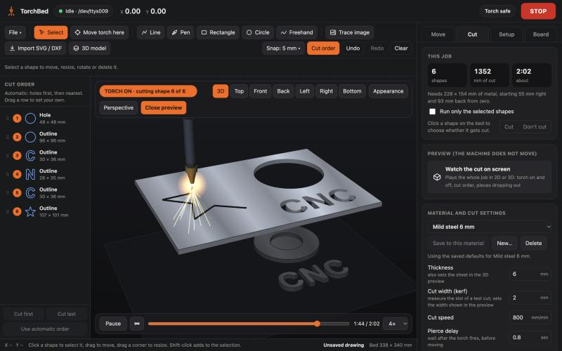

</div>

## What it does

TorchBed is a complete front end for a hobby or small-shop plasma table built on an Arduino running [GRBL](https://github.com/gnea/grbl):

- **Draw** with lines, a pen tool with curves, rectangles, circles and freehand, on a bed drawn at the real size of your machine.
- **Trace** a black and white picture into cut outlines.
- **Import** SVG and DXF drawings.
- **Slice 3D models** into flat panels the thickness of your metal, lay them out on as many sheets as it takes, and get an animated guide for welding them back together.
- **Preview** the whole job in 2D or 3D before any metal is touched.
- **Cut**, with dry runs, a torch arm switch, per-material settings and a stop that always works.
- **Set up the machine**: wiring diagram, GRBL settings editor and one-click firmware flashing, all built in.

> [!WARNING]
> **Project status: early, and not yet proven on real hardware.** Everything here has been developed and tested against simulators (a simulated GRBL controller and a simulated Arduino bootloader) and in the browser. Cutting on a real table and flashing a real board have not been validated yet. Treat it as experimental, do dry runs first, and read [Safety](#safety).

## 3D models into weldable metal

This is the part that makes TorchBed different. Load a 3D model, pick your metal, and it works out the flat pieces.

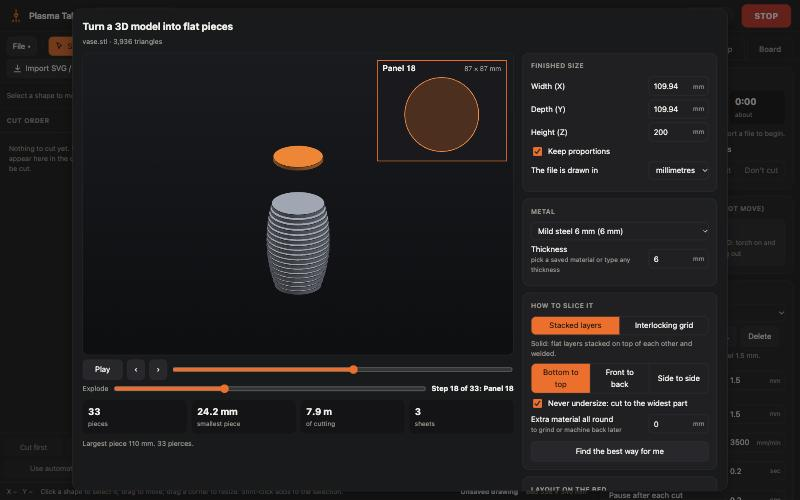

| | |
|---|---|
| **Stacked layers** for solid parts, in any of three directions. | **Interlocking grid** for frames: plates in two directions that slot together. |
| 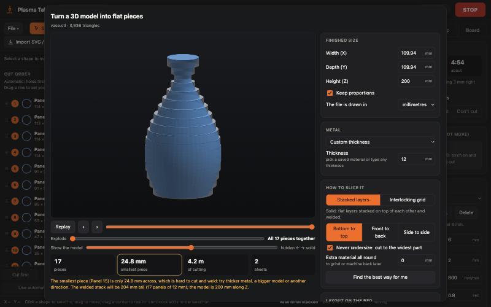 | 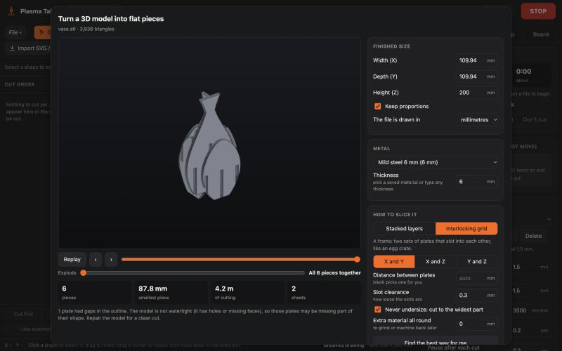 |
| **Find the best way** tries every option and ranks them by piece count, smallest piece, cutting length and sheets. | **Assembly guide** replays the build piece by piece, with an explode slider. |
| 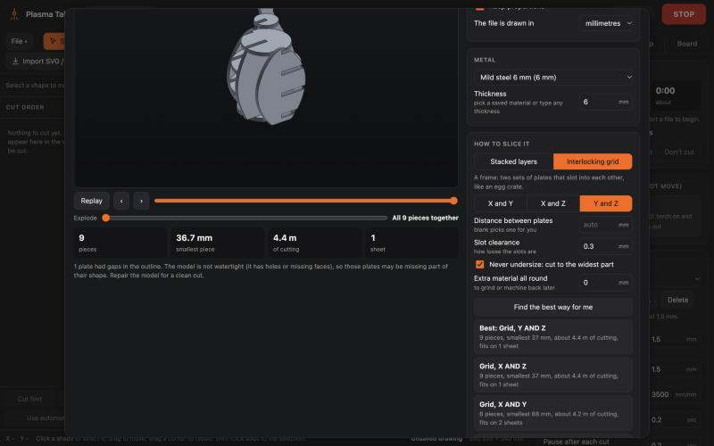 | 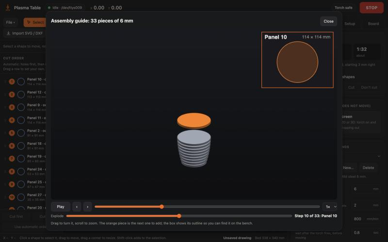 |

- **Never undersized.** Each piece is cut to the widest part of the model inside its thickness, and the stack is rounded up, so there is always metal to grind back and never a shortfall. An extra all-round allowance can be added for machining.
- **See what will be removed.** Fade the original model in over the pieces: metal showing outside it is what you would grind or mill away.
- **Know before you cut.** Piece count, smallest piece, total cutting length and number of sheets, with warnings for pieces too small to handle or too big for the bed.
- **Multi-sheet jobs.** Pieces are nested automatically and split across sheets; every piece is numbered on screen.

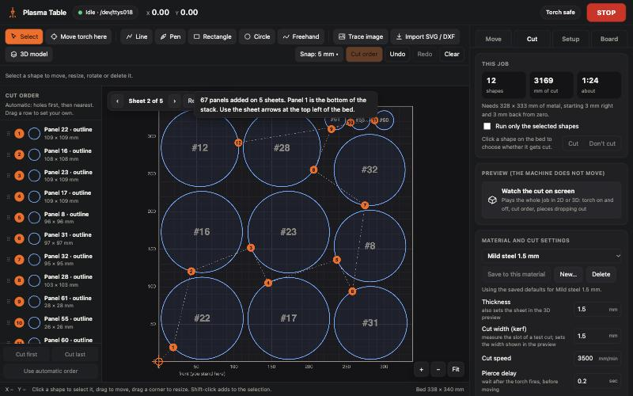

### Finish to shape

Stacked panels leave steps. Because TorchBed has both the welded shape and the true model, it can show exactly what has to come off, one side at a time: lay the part with a side up, remove what the map shows, turn it, repeat.

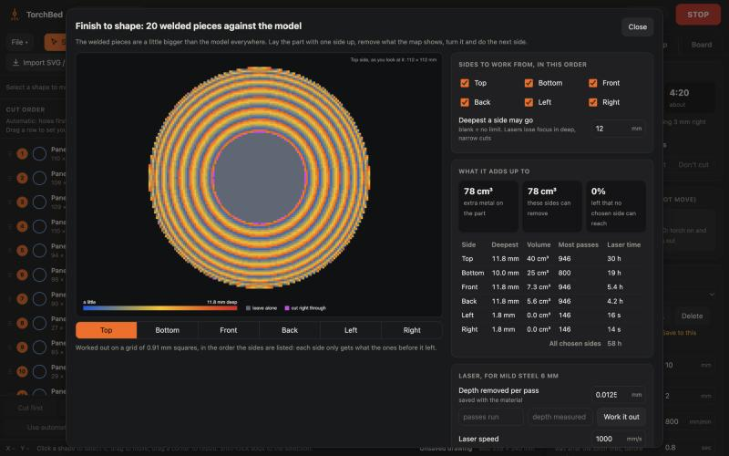

- A colour **depth map** for each side, plus how much volume each side can reach and what no side can.
- **Exports** as greyscale images that depth-engraving laser software reads, with notes on size, order and passes. They also work as a guide for milling or grinding.
- **Per-material laser calibration**: engrave a test square, measure the depth, and TorchBed turns depths into pass counts and time estimates.

More in the [finishing guide](docs/finishing.md).

### 3D file types

| Read directly in the app | Opened through [Blender](https://www.blender.org/) if it is installed | Not readable |
|---|---|---|
| STL, OBJ, GLB / glTF, 3MF, PLY, OFF, AMF, DXF with 3D faces | .blend, FBX, USD / USDZ, Alembic, X3D, 3DS | STEP, IGES, F3D and other CAD solids |

For CAD solids, export a mesh first. In Fusion: **File > Export** and choose 3MF, STL or OBJ. Files that state their unit (glTF, 3MF, AMF, some DXF) are sized automatically.

## Everything else

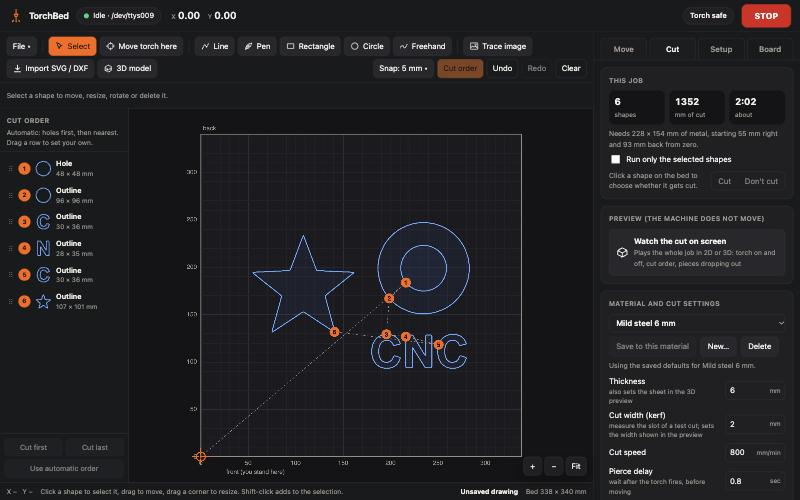

| | |
|---|---|
| **Image trace** with threshold, detail, smoothing and speck filter. | **Combine shapes**: join, subtract, overlap, difference. |
| 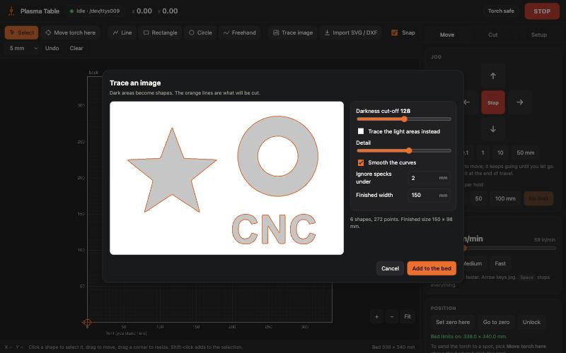 | 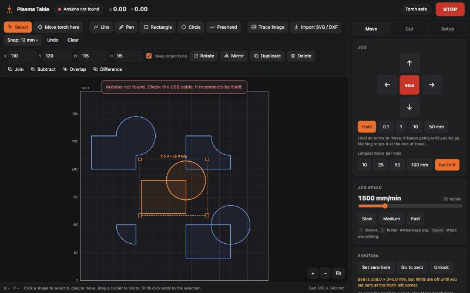 |
| **Materials** remember thickness, cut speed, pierce delay and cut width. | **Wiring diagram** for the controller board, pin by pin. |
| 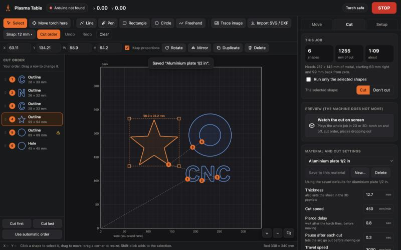 | 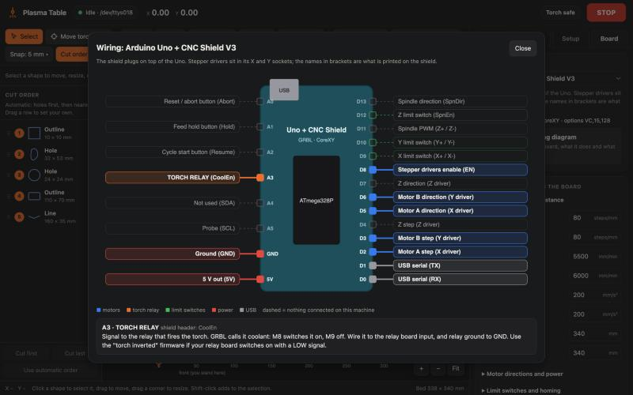 |

- **Cut order you control**: a list in cutting order, drag to rearrange, with a warning if an outline would be cut before what is inside it.
- **Cut preview**: timeline you can scrub, speeds from ¼× to 32×, perspective or orthographic, quick views, pieces dropping out as they are cut free.
- **Dry runs**: trace the bounding square or the real cut path with the torch off.
- **Click to move**: click a point on the bed and the torch goes there.
- **Units anywhere**: type `2in`, `27cm` or `2in + 2cm + 0.5ft` into any size box.
- **Projects**: save and reopen drawings with thumbnails; drafts are saved automatically and come back after a crash.
- **Board tools**: read and change GRBL's `$` settings in plain language, and flash firmware without avrdude.
- **Appearance**: colours for the bed, the preview and the 3D views, light and dark themes.

## Quick start

You need [Python 3.8 or newer](https://www.python.org/downloads/). Nothing else.

```bash
git clone https://github.com/joecodecreations/torch-bed-advanced-plasma-cutting.git
```

```bash
python3 torch-bed-advanced-plasma-cutting/jog/server.py
```

Then open http://127.0.0.1:8790. On Windows you can double-click `jog\start.bat`; on macOS, `jog/start.command`.

No machine yet? Everything except real cutting works without one, and there is a [simulator](docs/development.md#run-without-a-machine).

**First time at the machine**

1. **Move** tab: jog the torch to the front-left corner of the bed.
2. **Setup** tab: press *Front-left = zero*, jog to the back-right corner, press *Back-right*. That teaches the bed size.
3. Draw or import something, open the **Cut** tab, run both dry runs, then arm the torch and cut.

Full walkthrough: [docs/getting-started.md](docs/getting-started.md).

## Hardware

- Arduino Uno (or Nano) with a CNC Shield V3 or direct wiring, running GRBL 1.1h. Builds for CoreXY and standard X/Y machines are included in [`firmware/`](firmware/README.md) and can be flashed from the app.
- Two stepper motors and drivers.
- A relay board switching the torch trigger, wired to Arduino pin **A3** (labelled *CoolEn* on the shield). GRBL turns it on with `M8` and off with `M9`.

Details and the diagram: [docs/wiring.md](docs/wiring.md).

## Safety

Plasma cutting can blind, burn, electrocute and start fires. This software fires a torch under computer control.

- Wear proper eye protection and gloves, clamp and ground the work, keep flammables away, and never leave the machine running unattended.
- Keep a physical way to cut power within reach. The on-screen STOP, the Space bar and Escape stop motion and switch the torch off, but software is not an emergency stop.
- Use a relay board that switches on with a **HIGH** signal, or flash a "torch inverted" build. The wrong combination holds the torch on whenever the machine is idle.
- Do both dry runs before the first cut of any job.
- There is no torch height control and, unless you fit them, no limit switches.

The software is provided as is, with no warranty. See [LICENSE](LICENSE).

## Documentation

- [Getting started](docs/getting-started.md)
- [3D slicing guide](docs/3d-slicing.md)
- [Finishing to shape with a laser or mill](docs/finishing.md)
- [Wiring and boards](docs/wiring.md)
- [Firmware and flashing](docs/firmware.md)
- [Development, tests and the simulators](docs/development.md)
- [Roadmap](docs/roadmap.md)

## Contributing

Bug reports, test cuts on real machines and pull requests are very welcome. Start with [CONTRIBUTING.md](CONTRIBUTING.md). The most valuable thing right now is feedback from real hardware.

## Licence

TorchBed is released under the [MIT licence](LICENSE). The firmware images in `firmware/variants` are builds of GRBL and are licensed under the GNU GPL v3; see [firmware/README.md](firmware/README.md).
