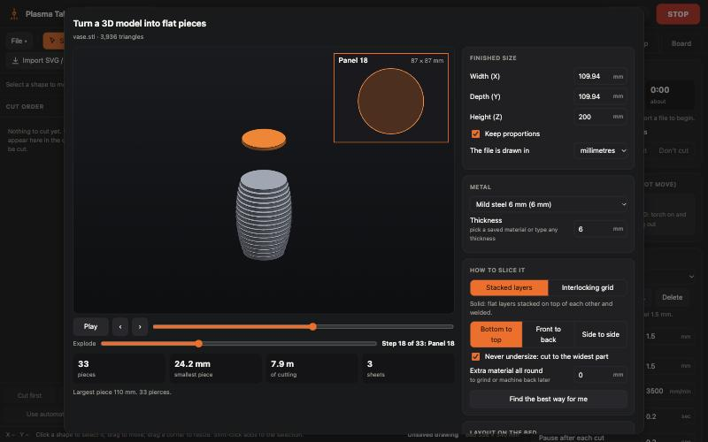
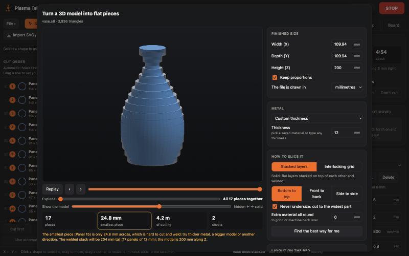
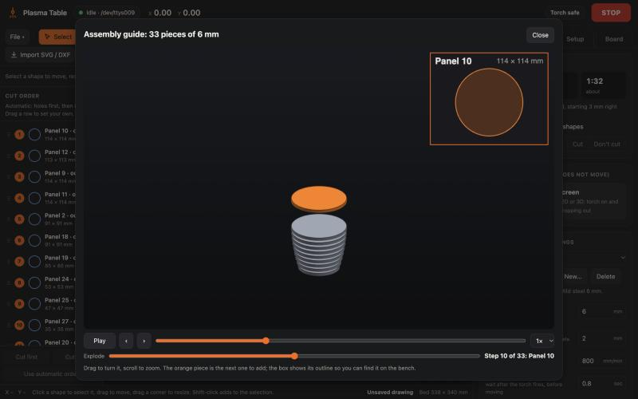

# 3D slicing guide

TorchBed turns a 3D model into flat pieces you cut from sheet metal and weld into the object.

## Steps

1. Press **3D model** and choose a file (or drop it on the bed).
2. **Finished size:** type any one dimension; the others follow while *Keep proportions* is ticked. If the file has no unit, pick what it was drawn in.
3. **Metal:** pick a saved material, or choose *Custom thickness* and type one.
4. **How to slice it:**
   - **Stacked layers** gives a solid: flat layers stacked bottom to top, front to back, or side to side.
   - **Interlocking grid** gives a frame: two sets of plates with half-depth slots, like an egg crate. Choose which two directions, the distance between plates and the slot clearance.
   - **Find the best way for me** tries all six and ranks them.
5. Read the tiles: **pieces**, **smallest piece**, **metres of cutting**, **sheets**. A warning appears when a piece is too small to cut and weld comfortably or too large for the bed.
6. Press **Play** to watch it go together, step with the arrows, drag the timeline, and use **Explode** to pull the pieces apart.
7. **Add the pieces to the bed.** They are nested with the gap you set and split over sheets if needed.

## Always more metal, never less

- **Never undersize** (on by default) cuts each piece to the widest part of the model anywhere inside its thickness, not the middle. Stepped edges therefore sit outside the true surface.
- The number of layers is rounded **up**, so a stack is never shorter than the model.
- **Extra material all round** adds a margin on every outline (and shrinks holes) for grinding or CNC milling afterwards.
- **Show the model** fades the original model in over the pieces. Metal outside the blue is what would be removed; blue outside the metal would be a shortfall.

## After cutting

Each piece shows its number on the bed (`#1` is the bottom of a stack; grid plates are named by direction, such as `X3`). Mark them as they come off the table. **Assembly** in the toolbar replays the build at any time, and is saved with the drawing.

## File types

| Read directly | Through Blender, if installed | Not readable |
|---|---|---|
| STL (binary and text), OBJ, GLB, glTF with embedded data, 3MF, PLY, OFF, AMF, DXF with 3D faces | .blend, FBX, USD / USDA / USDC / USDZ, Alembic, X3D / VRML, 3DS | STEP, IGES, F3D, SAT and other CAD solids |

- Blender is found automatically in its usual install place, or set `JOG_BLENDER` to its path. Scripts stored inside a `.blend` are never run.
- For CAD solids export a mesh: in Fusion, **File > Export** as 3MF, STL or OBJ, or right-click a body and **Save As Mesh**.
- A glTF that refers to separate `.bin` files cannot be loaded; export a single `.glb`.

## Limits worth knowing

- The model should be watertight. Gaps in the mesh give a warning and may leave a piece incomplete.
- Nesting packs by bounding box with 0° or 90° turns; it does not tuck parts inside each other.
- Grid joints are not checked for whether the whole frame can physically slide together; crossings with too little material are left unslotted and reported.
- Three-direction slicing is not implemented.
- There is no kerf compensation yet: parts come out smaller, and holes larger, by about the cut width.
