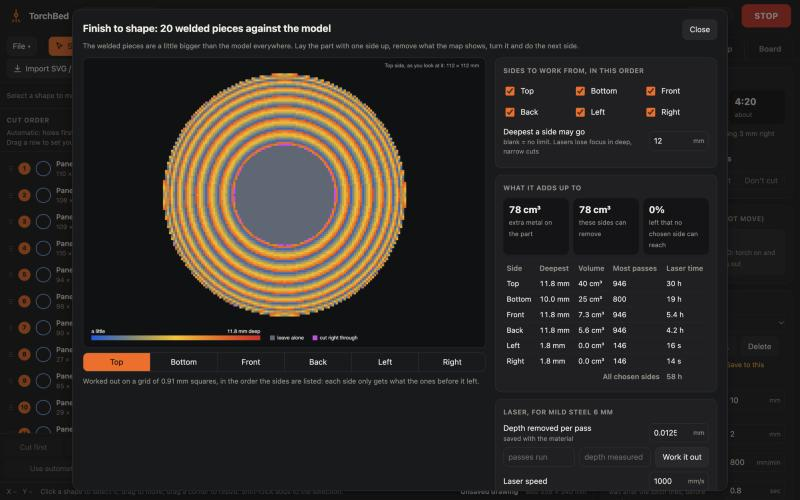
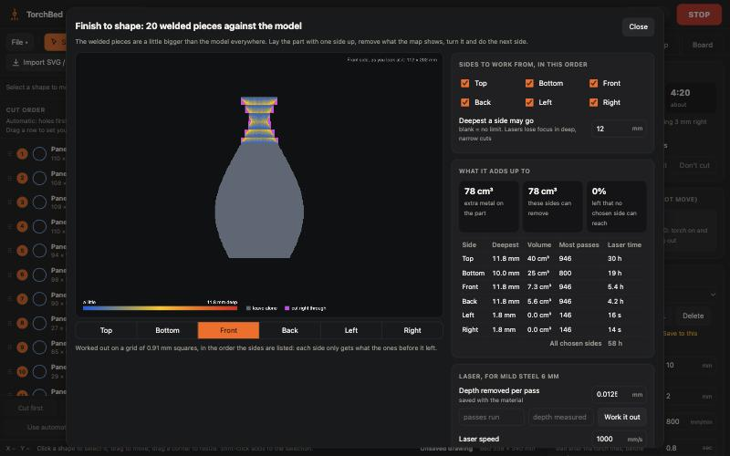

# Finishing to shape

Stacked panels approximate a model in steps. TorchBed keeps both shapes, so it can tell you exactly what to remove to get from the welded part to the real surface.

## How it works

1. Slice a 3D model and add the pieces to the bed as usual. Cut and weld them.
2. Open **Assembly**, then **Finish to shape…**.
3. Tick the **sides you can work from**. Think of laying the part on a table with that side facing up.
4. Read the map for each side: grey is leave alone, blue through red is shallow through deep, magenta means cut right through (metal that sits outside the model altogether).

Sides are worked in the order listed, and each one only gets what the earlier ones left, so the numbers never count the same metal twice. The tiles show the total extra metal, how much the chosen sides can reach, and how much no chosen side can.

**Deepest a side may go** limits how far below the surface a side reaches. Lasers lose focus in deep, narrow cuts and cutters have limited reach, so set this to what your tool can really do and let another side take the rest.

## Using a laser

A fiber laser removes metal slowly, so check the time column before committing: it is easy to ask for days of engraving. It suits thin layers, small parts and fine detail far better than thick stacks.

### Calibrate per material

1. Press **Save a 10 mm test square** and engrave it on scrap of the same metal for a set number of passes at your usual settings.
2. Measure the depth of the pocket.
3. Type the passes and the depth and press **Work it out**. The depth per pass is stored with the material (press **Save to this material** on the Cut tab to keep it).
4. Enter your laser's **speed** and **line spacing** so the time estimate matches.

Depth per pass falls as a pocket gets deeper, because the beam drifts out of focus and debris builds up. Calibrate at the depth you expect to work at, and check the depth as you go.

### Export

**Save every side and notes** writes one PNG per side and a text file. In the images white means leave alone and darker means deeper, with black the deepest cut for that side. The notes give each image's real size in millimetres, the order to run them, the deepest cut and how many passes black stands for. Depth-engraving modes in laser software such as LightBurn and EZCAD take images like these.

## Using a mill or grinder

The same maps work as a roughing guide: the depth figures are real millimetres measured from the surface of that side.

## Limits

- The comparison is done on a grid (the size is shown under the map, typically well under a millimetre for hand-sized parts). Treat edges as accurate to about one grid square.
- Only straight-down reach from each side is considered. Undercuts hidden from every chosen side are reported as left over.
- TorchBed does not drive a laser itself; it prepares the maps.
- The laser time is an estimate from depth per pass, speed and line spacing. It ignores travel between areas and the drop-off with depth.
- This feature has been tested in software only, not with a real laser.
