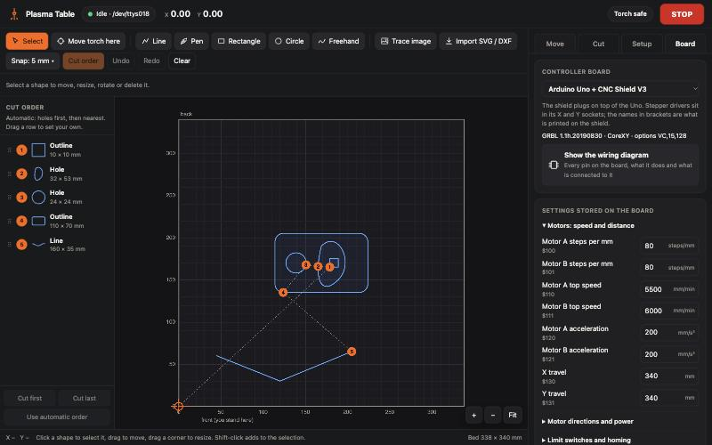

# Firmware and flashing

TorchBed talks to stock [GRBL 1.1h](https://github.com/gnea/grbl). Four builds are included; see [firmware/README.md](../firmware/README.md) for which to use and where the source is.



## Flashing from the app

1. **Board** tab, **Firmware** card: choose a build.
2. Press **Flash this firmware…** and confirm.
3. The app first reads what is on the board and saves it to `firmware/backups/`, then writes the new firmware and reads it back to check every byte. About 20 seconds.

No avrdude or Arduino IDE is needed: the app speaks the bootloader's protocol (STK500v1, as used by Optiboot) itself.

- Your `$` settings live in the Arduino's EEPROM and are not touched.
- To go back, flash the newest file under *backups*.
- The bootloader is never overwritten, so a failed flash can simply be repeated.
- Boards without auto-reset (some clones) need the reset button pressed as flashing starts.

> The flasher has been tested thoroughly against a simulated bootloader, but not yet on a physical board. Please report how it goes.

## Settings stored on the board

The same tab reads GRBL's `$` settings and shows them in plain language (steps per mm, top speed, acceleration, motor direction, homing and so on). Changes are written to the board immediately; the machine must be idle.

For a CoreXY machine `$100` and `$101` are the two motors and must be equal.

## Building the firmware yourself

```bash
scripts/build_firmware.sh
```

Needs `git` and `arduino-cli` with the `arduino:avr` core.
