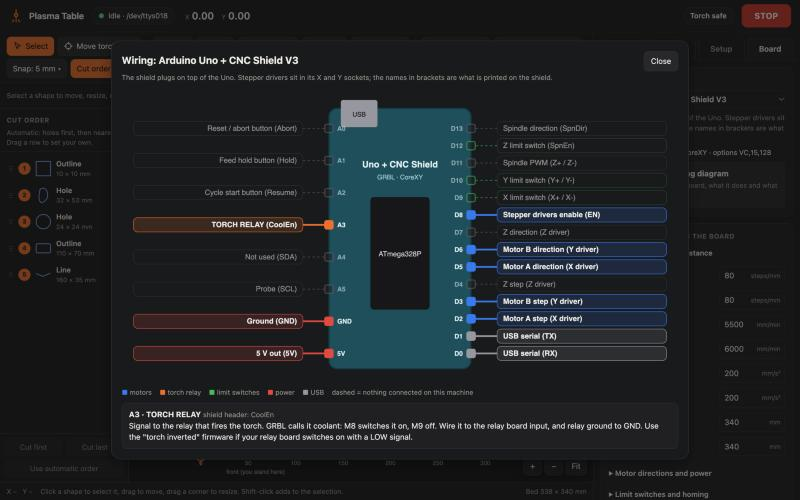

# Wiring and boards

The **Board** tab has a live version of this: pick your board and press **Show the wiring diagram**. Hover a pin for what it does.

## Supported boards

| Board | Notes |
|---|---|
| Arduino Uno + CNC Shield V3 | The reference setup. Names in brackets below are what is printed on the shield. |
| Arduino Uno, wired directly | Same pins, wires straight to the headers. |
| Arduino Nano (ATmega328P) | Same chip and pins. Older Nanos have a larger bootloader; the app detects this and refuses a firmware image that would not fit. |

## Pin map (GRBL 1.1, ATmega328P)

| Pin | Function | Used here |
|---|---|---|
| D2 | X / motor A step (X driver) | yes |
| D3 | Y / motor B step (Y driver) | yes |
| D5 | X / motor A direction | yes |
| D6 | Y / motor B direction | yes |
| D8 | Stepper enable (EN) | yes |
| D9, D10 | X and Y limit switches (X+/X-, Y+/Y-) | optional |
| D12 | Z limit (SpnEn) | no |
| D4, D7 | Z step and direction | no |
| D11, D13 | Spindle PWM and direction | no |
| A0, A1, A2 | Abort, Hold, Resume buttons | optional |
| **A3** | **Torch relay (CoolEn)** | **yes** |
| A5 | Probe (SCL) | no |
| 5V, GND | Relay board power and common ground | yes |

## Torch relay

1. Relay signal input to **A3**, relay ground to **GND**, relay VCC to **5V**.
2. Relay contacts across the torch's trigger wires.
3. Use a relay board that switches **on with a HIGH signal**. If yours switches on LOW, flash one of the "torch inverted" firmware builds; otherwise the torch would be held on whenever the machine is idle.
4. Test with **Setup > Test the relay** with the torch lead unplugged first.

The on and off commands (`M8` / `M9`) can be changed in the Setup tab if you wire the relay to a different output.

## Plasma noise

Plasma cutters throw a lot of electrical noise. Keep the Arduino and USB cable away from the torch lead, use a short shielded USB cable (a ferrite helps), and ground the table. If the controller stops answering mid-cut, the app resets it and tells you; noise is the usual cause.
